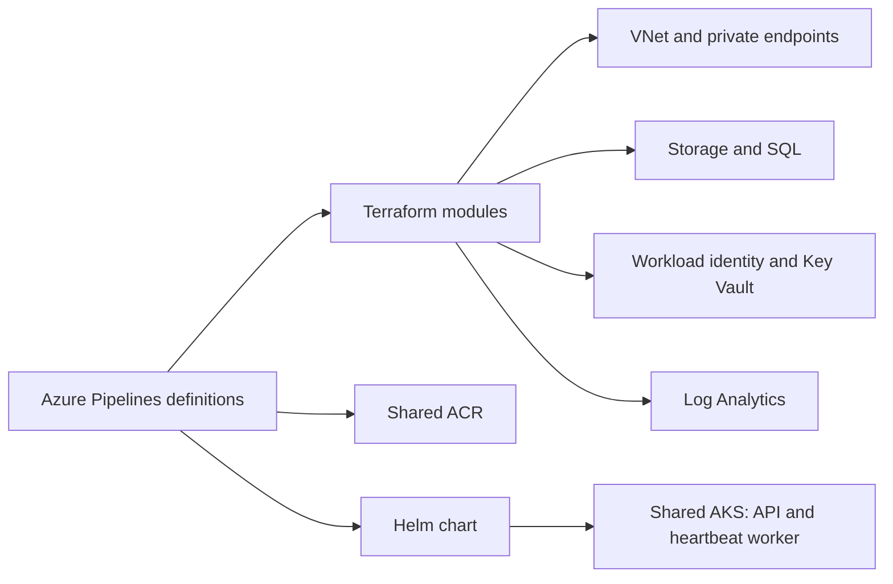

# Northbridge Health referral platform on Azure

Terraform configuration, a small API and worker, a Helm chart and Azure Pipelines for an Azure training platform.

**Status: incomplete reference implementation (Keep).** This GitHub copy has no retained deployment-verification evidence. No production, resilience, recovery or security-control validation is claimed. It is not synced from the Azure DevOps project.

## What exists

| Path | Contents |
|---|---|
| `app/api/main.py` | FastAPI health/readiness endpoints and a referral echo endpoint; no persistence |
| `app/worker/main.py` | Periodic heartbeat process; no referral queue processing |
| `app/Dockerfile.api`, `app/Dockerfile.worker` | Multi-stage non-root image definitions |
| `infra/environments/dev`, `prod` | Terraform roots referencing shared AKS and ACR |
| `infra/modules/` | Networking, data, Key Vault, observability, private DNS/endpoints and workload-identity modules |
| `deploy/helm/referrals/` | API/worker Deployments, Services, ingress, HPA, PDB, NetworkPolicy and service accounts; shared and dev values |
| `pipelines/terraform-pr.yml`, `terraform-apply.yml`, `app.yml` | Azure Pipelines definitions requiring external service connections and a self-hosted agent |
| `docs/architecture.md`, `docs/bootstrap.md` | Dependency/design notes and bootstrap instructions |

## Configuration flow

This diagram shows the intended relationships in the committed configuration, not a verified deployed system.



AKS and ACR are external dependencies, not provisioned by this repository. Private endpoints and workload-identity resources are declared; the sample applications do not demonstrate their use.

## Validation level

**Source/configuration review only for this GitHub copy.** Terraform validation currently fails because dev `main.tf` declares `private_dns` and `private_endpoints` twice. Resolve that separately before planning or applying. Azure Pipelines YAML alone does not prove a successful pipeline run or deployment.

Review locally with installed tools:

```sh
terraform -chdir=infra/environments/dev validate
helm lint deploy/helm/referrals
helm template referrals deploy/helm/referrals -f deploy/helm/referrals/values-dev.yaml
docker build -f app/Dockerfile.api app
docker build -f app/Dockerfile.worker app
```

These commands inspect/build configuration; they do not prove cloud integration. Configure identities, service connections, backend and environment values before any deliberate deployment.

## Known limitations

- The API echoes submitted data; the worker only logs a heartbeat.
- No scheduled drift pipeline, load/resilience/network-policy verification scripts or prod Helm values are present.
- Cost, drift, identity, operations, rebuild and resilience documents are placeholders, not evidence.
- No validated dashboard, alert firing, load test, rollback, restore or rebuild result is retained here.
- Shared ACR is documented with public/admin access; do not infer a verified private production perimeter.
- No patient data or compliance claim. Use synthetic data only.

## Next steps

Resolve duplicate Terraform module blocks, validate the configuration, then capture reproducible evidence for each implemented capability. The Azure DevOps source is intentionally not imported in this change.
